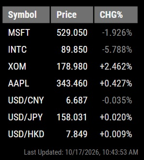

# MMM-MarketLite

A lightweight stock and forex market module for MagicMirror.

MMM-MarketLite displays selected stock and foreign exchange symbols using data from the Twelve Data API in a compact Bloomberg-inspired layout.

## Screenshot



Example configuration shown:
- MSFT
- INTC
- XOM
- AAPL
- USD/CNY
- USD/JPY
- USD/HKD

## Features

- Stock and Forex market data
- Twelve Data API integration
- Configurable symbols
- Configurable refresh interval
- Configurable font size
- Positive/negative percentage indicators
- Bloomberg-style table header
- Designed for low-resource devices such as Raspberry Pi Zero W

## Why MMM-MarketLite?

MMM-MarketLite was developed for a Raspberry Pi Zero W running a stable MagicMirror installation.

The Raspberry Pi Zero and Zero W use a 32-bit ARMv6 processor architecture. While still capable of running MagicMirror reliably, they face increasing compatibility challenges with modern software. 
This module would also work on any other 32-bit or 64-bit MagicMirror platforms.  It is simple and also has the best backward compatibility.

Examples include:

- Chromium support effectively stopping at Chromium 95
- Newer Node.js, Electron and browser versions becoming more difficult to support
- Existing market modules depending on Yahoo Finance, browser scraping, unofficial APIs, or newer software stacks

Many users prefer to keep a stable MagicMirror system running for years instead of continually upgrading operating systems, browsers and dependencies.

MMM-MarketLite takes a different approach:

- Uses the Twelve Data API
- Uses simple HTTPS JSON requests
- Works well with Node.js 16
- Runs comfortably on Raspberry Pi Zero / Zero W
- Does not depend on Yahoo Finance
- Does not require the latest operating system or browser

If you are running MagicMirror on a Raspberry Pi Zero, Zero W, or another older 32-bit platform and are having difficulty maintaining Yahoo Finance based market modules, MMM-MarketLite was designed with that situation in mind.

## Requirements

- MagicMirror²
- Twelve Data API Key

A free API key may be obtained from:

https://www.twelvedata.com/

## Installation

Copy the module into your MagicMirror modules directory:

```bash
cd ~/MagicMirror/modules
git clone https://github.com/jionglu/MMM-MarketLite.git
```

## Configuration

Add the module to your `config.js`:

```javascript
{
    module: "MMM-MarketLite",
    position: "bottom_right",

    config: {
        apiKey: "YOUR_API_KEY",

        updateInterval: 900,

        fontSize: "16px",

        symbols: [
            "MSFT",
            "AAPL",
            "USD/JPY",
            "USD/HKD"
        ]
    }
}
```

## Configuration Options

| Option | Description | Default |
|----------|----------|----------|
| apiKey | Twelve Data API key | Required |
| updateInterval | Refresh interval in seconds | 900 |
| fontSize | Display font size | 16px |
| symbols | Stocks and Forex symbols | [] |

## Notes

- Maximum supported symbols: 7.  You can change this limit in MMM-MarketLite.js and node_helper.js 
- Supports stocks, ETFs and forex pairs available through Twelve Data
- Twelve Data index symbols were tested but did not return data through the quote endpoint
- Do not set updateIntervals under 120 (seconds).  Twelve data's free account has a daily limitation of 800 calls.

## Version History

### v1.0

- Initial public release
- Stock and Forex support
- Batch query support
- Auto refresh
- Configurable symbols and font size
- Bloomberg-style display

## Author

Jiong Lu

Developed with assistance from Microsoft Copilot.
